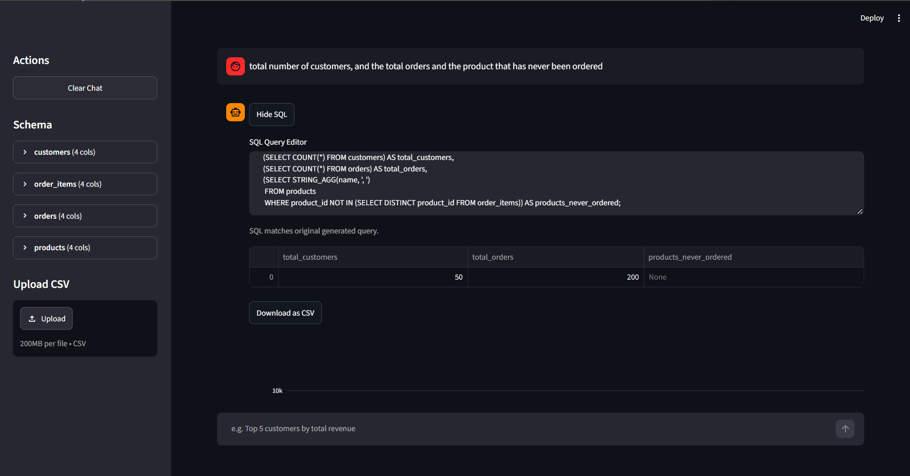

# SqlSense – Natural Language to SQL Analytics

A conversational data analytics application that translates plain English business questions into validated, read-only DuckDB SQL queries, executes them instantly, and renders interactive tables, charts, and downloadable CSV exports. Powered by Google Gemini, LangChain, DuckDB, SQLAlchemy, and Streamlit.



---

## Overview

SqlSense bridges the gap between non-technical stakeholders and relational databases. Users ask questions naturally (e.g., *"Top 5 customers by total revenue"* or *"Monthly sales trends for Electronics"*), and the system automatically prompts Google Gemini, parses and validates the generated SQL for safety, executes the query against DuckDB, and displays the result alongside auto-selected Plotly charts.

---

## Key Features

- **Natural Language to SQL**: Converts analytical queries into DuckDB-compatible SQL statements using Gemini LLMs.
- **AST-Level SQL Safety Guardrails**:
  - Enforces read-only execution using DuckDB's native parser (`duckdb.extract_statements` and `duckdb.tokenize`).
  - Restricts execution strictly to single-statement `SELECT` queries (including CTEs with `WITH`).
  - Blocks destructive write or DDL operations (`INSERT`, `UPDATE`, `DELETE`, `DROP`, `ALTER`, `CREATE`, `TRUNCATE`, `ATTACH`, `DETACH`, `EXPORT`, `IMPORT`, `VACUUM`).
  - Rejects multi-statement execution attempts and SQL injection vectors.
- **Automatic Execution with Preview Workflow**:
  - LLM-generated SQL executes immediately to deliver fast answers and charts.
  - Optional **Preview SQL** toggle allows users to inspect the query in an editable editor.
  - Automatically detects query modifications: edited SQL requires explicit user approval via **Execute Modified SQL** and undergoes full safety validation.
- **Interactive Visualizations**: Heuristic engine automatically generates appropriate Plotly charts based on result data types (time series line charts, categorical bar charts, numerical scatter plots).
- **CSV Data Export**: One-click **Download as CSV** button for query results with preserved headers and types.
- **Conversation History**: Multi-turn session memory allows conversational follow-up questions while automatically sanitizing API keys and credentials.
- **Sidebar Data Management**:
  - Schema browser with table definitions and column types.
  - Custom CSV uploader to dynamically attach and query custom tables alongside demo data.
  - **Clear Chat** action in the left sidebar to reset session state cleanly.
- **Session-Isolated Storage**: Temporary tables and user uploads are sandboxed and cleaned up on session restart.

---

## Demo Dataset

The application initializes with four pre-seeded e-commerce tables (generated deterministically with `numpy.random.default_rng(42)`):

| Table | Rows | Key Columns | Description |
|---|---|---|---|
| `customers` | 50 | `customer_id`, `name`, `country`, `signup_date` | Registered customer directory across 8 countries |
| `products` | 20 | `product_id`, `name`, `category`, `price` | Product catalog spanning 5 retail categories |
| `orders` | 200 | `order_id`, `customer_id`, `order_date`, `status` | Order transactions (`completed`, `shipped`, `cancelled`) |
| `order_items` | 400 | `order_id`, `product_id`, `quantity`, `unit_price` | Itemized order lines mapped to product prices |

---

## Tech Stack

- **UI & Application**: [Streamlit](https://streamlit.io/)
- **Database Engine**: [DuckDB](https://duckdb.org/) with [duckdb-engine](https://github.com/Mause/duckdb_engine)
- **ORM / Connection Pool**: [SQLAlchemy](https://www.sqlalchemy.org/) (`<=2.0.35`)
- **LLM Orchestration**: [LangChain](https://www.langchain.com/) (`langchain`, `langchain-community`, `langchain-google-genai`)
- **LLM Provider**: [Google Gemini](https://ai.google.dev/) (`gemini-3.1-flash-lite`, configurable)
- **Data & Charts**: [Pandas](https://pandas.pydata.org/), [NumPy](https://numpy.org/), [Plotly Express](https://plotly.com/python/plotly-express/)
- **Configuration**: [python-dotenv](https://github.com/theskumar/python-dotenv)

---

## Project Structure

```
sqlsense/
├── .env.example          # Environment variable template
├── .gitignore            # Git exclusion rules for Python, virtualenvs, and databases
├── app.py                # Main Streamlit application, UI layout, and query orchestrator
├── requirements.txt      # Project Python dependencies
├── Screenshot.png        # Application user interface preview
├── sql_safety.py         # AST parser, SQL safety validator, and SafeSQLDatabase wrapper
├── test_sql_safety.py    # Unit test suite for validation rules and execution workflows
└── README.md             # Project documentation
```

---

## Prerequisites

- **Python**: Version 3.10, 3.11, or 3.12
- **Google AI Studio API Key**: Free tier available from [Google AI Studio](https://aistudio.google.com/apikey)

---

## Installation & Setup

### 1. Clone the Repository

```bash
git clone https://github.com/your-username/sqlsense.git
cd sqlsense
```

### 2. Create a Virtual Environment

**Windows (PowerShell):**
```powershell
python -m venv .venv
.venv\Scripts\Activate.ps1
```

**Windows (Command Prompt):**
```cmd
python -m venv .venv
.venv\Scripts\activate.bat
```

**macOS / Linux:**
```bash
python3 -m venv .venv
source .venv/bin/activate
```

### 3. Install Dependencies

```bash
pip install --upgrade pip
pip install -r requirements.txt
```

> **Note on SQLAlchemy**: `requirements.txt` pins `sqlalchemy<=2.0.35` to ensure stable compatibility with `duckdb-engine` without catalog reflection exceptions.

---

## Environment Configuration

1. Copy the example environment file:

   **Windows:**
   ```cmd
   copy .env.example .env
   ```

   **macOS / Linux:**
   ```bash
   cp .env.example .env
   ```

2. Open `.env` and insert your Gemini API key:

   ```ini
   # Google Gemini API Key
   GOOGLE_API_KEY=your_gemini_api_key_here

   # Optional: Model override (default: gemini-3.1-flash-lite)
   GEMINI_MODEL=gemini-3.1-flash-lite
   ```

---

## Running the Application

Launch the Streamlit web server:

```bash
streamlit run app.py
```

The application will start and open automatically in your browser at:
`http://localhost:8501`

---

## Usage Guide

1. **Ask a Question**: Type an analytical prompt in the chat box at the bottom of the page:
   - *"Which 5 customers have generated the most revenue?"*
   - *"What is the breakdown of order statuses?"*
   - *"Show total sales by product category as a bar chart."*
2. **Automatic Results**: The assistant generates safe SQL, executes it against DuckDB, and renders the result dataframe alongside an auto-selected chart.
3. **Inspect & Edit SQL**:
   - Click **Preview SQL** under any assistant response.
   - Modify the query directly in the code editor.
   - The app detects edits and displays an **Execute Modified SQL** button. Click it to re-validate and execute your modified query.
4. **Download Data**: Click **Download as CSV** below any table to export the query results.
5. **Upload Custom CSVs**: Use the **Upload CSV** widget in the left sidebar to add custom tables to the DuckDB instance.
6. **Reset Session**: Click **Clear Chat** in the left sidebar to clear the conversation history and start fresh.

---

## Testing

The project includes unit tests for SQL validation, AST safety parsing, workflow logic, and credential sanitization:

### Run Unit Tests

```bash
python -m unittest test_sql_safety.py
```

All 29 tests cover:
- Valid `SELECT` queries with joins, CTEs, filters, and aggregations.
- Blocked destructive operations (`DROP`, `DELETE`, `UPDATE`, `INSERT`, `ALTER`, `TRUNCATE`, `CREATE`).
- Multi-statement injection defense.
- DuckDB syntax verification and token inspection.
- Conversation credential sanitization.
- Generated vs. modified SQL execution workflows.

### Run Smoke Test

```bash
python app.py smoke
```

Verifies DuckDB in-memory table generation and basic SQL validation rules.

---
